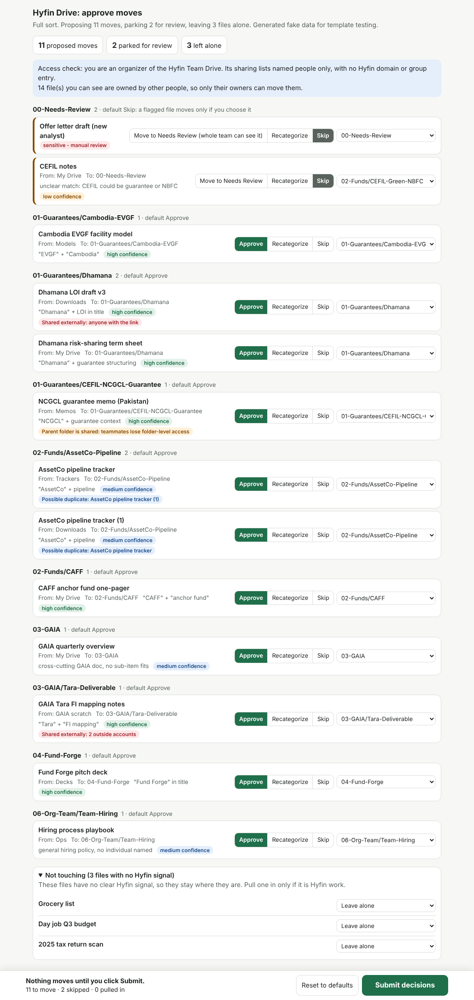
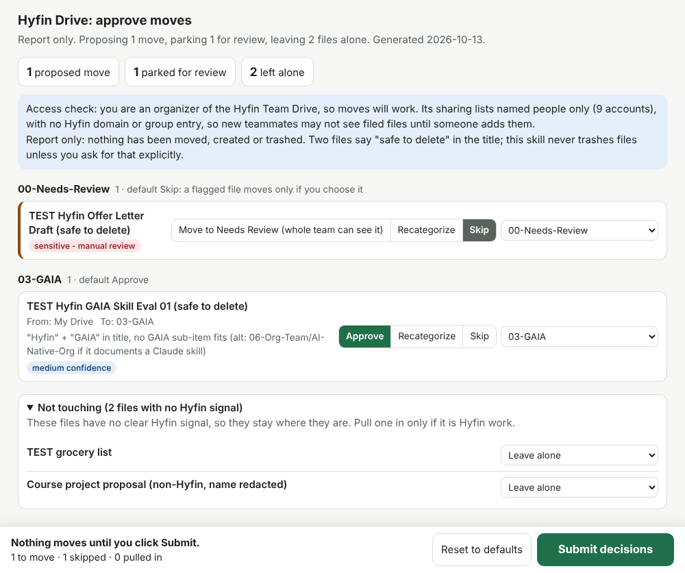

# Week 3 Write-up: `hyfin-drive-organizer`

**Skill:** `hyfin-drive-organizer`, in `week3/hyfin-drive-organizer/`.
**Target "repo":** my own Google Drive workspace, the shared drive "Hyfin Team Drive" plus my personal My Drive. The instructors agreed this counts, so wherever the assignment says "repo", read "the Drive".

This repository is public. Before committing, I replaced vendor, team-member and named-deal names with `[REDACTED]`, and Drive IDs and real filenames with placeholders. The copy I tested, and the one Hyfin installs, has the real terms.

## 1. The workflow and why it is a skill

Hyfin runs six workstreams: Guarantees, Funds, GAIA, Fund Forge, BUS and Org/Team. Everyone on the team, me included, piles Hyfin documents into their personal My Drive. Those files belong in the shared drive's workstream tree, where teammates can find them. The workflow is: find my own Hyfin files in My Drive, decide where each belongs, show that plan to a human, and move only what they approve. Every teammate runs it, and the plan is to run it weekly.

Almost every step needs judgment. Is the file Hyfin at all, or a day-job spreadsheet or a payslip? Is it sensitive, so it shouldn't be guessed about? Which of 20 folders fits, and what if two do? Is it shared outside Hyfin? Can the connector make this move, or does it need the browser? And at the end, the person decides per file: approve, recategorize or skip.

### How I ran it manually first

I ran this by hand, then with better and better instructions, many times before writing the skill. Each lesson is now in it.

1. **The first version proposed moves inside the shared drive's legacy folders.** That reshuffled folders teammates reach through folder-level shares. Lesson: scope is My Drive files the runner owns, never shared-drive contents.
2. **The connector moves files from My Drive into the shared drive, and nothing else.** Every move inside the shared drive failed with "The caller does not have permission" (10 of 10, as an organizer), and folders can't be moved at all. Lesson: keep a second route through the Drive web UI.
3. **The browser pane lags.** Screenshots trail clicks by a step, menus land elsewhere in the 800 px frame, and one blind click hit "Move to trash" (cancelled, nothing deleted). Lesson: screenshot after a right-click, move one item at a time, and verify every move from metadata, not the screen.
4. **Scheduled runs are unattended.** A weekly report-only run moved nothing, correctly. It also refused a move I passed in as fire-time text, also correctly. Authorization written into a saved task prompt did work. Lesson: authorization lives in a saved prompt, never in fire-time text.
5. **The approval widget needed a louder Submit.** I clicked Approve and thought nothing happened, because only Submit sends decisions. Lesson: a big green Submit button and the line "Nothing moves until you click Submit".
6. **Sharing can change inside a shared drive.** During a 24-row reorganization, a `.docx` lost its two outside collaborators, while a Slides file and an anyone-with-the-link file kept theirs. Lesson: snapshot permissions before moving an externally shared file, diff afterwards, and report any difference.

## 2. The skill

### Structure

The original was one 33 KB file, about 8,300 tokens at roughly chars/4, because the tool I first saved it with stored only one file. Now `SKILL.md` keeps what every run needs, and the rest loads only when a step calls for it.

| File | Contents | Why it's separate |
|---|---|---|
| `SKILL.md` (123 lines, ~3,200 tokens) | Scope, safety rules, modes, 10-step pipeline, decision rules, gotchas | Loads on every trigger, so it holds only judgment and order |
| `references/taxonomy.md` | Folder tree, cue table, tie-breaks | Read at step 3. The script parses the tree from it, so there is one source of truth |
| `references/sensitivity.md` | What counts as sensitive and why to over-flag | Read before the first classification |
| `references/browser-pane-moves.md` | Route 5A step by step | Only for folders or moves inside a shared drive |
| `references/connector-moves.md` | Route 5B: plan table, order, verification | Read before the first connector move |
| `references/weekly-schedule.md` | Weekly report-only task and the optional permission test | Schedule mode only |
| `assets/approval-report.html`, `.txt` | Interactive template and plain-text layout | Long, and only needed at step 7 |
| `scripts/build_report.py` | Validates the report data and renders both formats | The deterministic part, done in code |

Each reference is one level deep and introduced with "read X when Y" at the step that needs it. The gotchas stay in `SKILL.md`.

### The description (987 characters)

```
Files a Hyfin team member's own Hyfin work from their personal My Drive into the Hyfin Team Drive's six-workstream folders (Guarantees, Funds, GAIA, Fund Forge, BUS, Org/Team). It proposes a destination for each file, shows an approval table, and moves only what the person approves. Use this skill whenever someone wants to organize, sort, tidy or clean up their Hyfin files or Drive, asks where a Hyfin doc should live, wants files moved into the team drive or "the new structure", has GAIA, Tara, Dhamana, CEFIL, CAFF or Fund Forge docs scattered in their Drive, wants a preview of proposed moves, or asks to run or schedule the weekly Hyfin Drive sync. Use it even if they never say "skill" or name a folder. It only touches files the person owns in their own My Drive and leaves personal or day-job files and everything already inside a shared drive alone. Not for renaming or editing a single file, sharing or permissions, finding a file, or questions about what a folder contains.
```

The trigger list uses the words teammates actually type ("tidy", "where should this live", "the new structure", "weekly sync"). Workstream names are there because people say "my GAIA docs" without ever saying "Drive". The scope sentence keeps it off personal cleanups. The final "Not for" sentence hands off neighbouring jobs to the Google Workspace skill or plain search. My first draft was 1,035 characters, and `skills-ref validate` rejected it.

### Encoded judgment

The **Hyfin gate** runs first. A file with no Hyfin signal is left alone and never reaches the sensitivity check; otherwise a day-job payslip would turn into a "sensitive file proposed for the team drive". The **sensitivity** check runs second, on filename, path and title only, and flags when in doubt. The **taxonomy** runs third: the more specific folder when two fit, the workstream's top folder for cross-cutting documents, and `00-Needs-Review` instead of a forced guess. The skill always **moves, never copies**, because a copy breaks every link already sent. The **safety rules** are prescriptive because those steps are fragile: no move without a submitted approval, no sharing changes, no trashing, no browser sign-in, no retry loops. The skill does not edit files, touch sharing, reorganize the shared drive, move other people's files, or let a scheduled run move anything.

The gotchas section lists the specific mistakes an agent would make here (see `SKILL.md`). Testing added one: **My Drive's root and a shared drive's root both have `0A…` IDs.** My draft said "shared-drive roots start with `0A`", and my own My Drive proved that wrong. The skill now tells the two apart by metadata: "My Drive" with an owner, versus "Drive" with no owner.

### The approval report as plan-validate-execute

The report is the plan, the human is the validator, and execution waits for Submit. `build_report.py` adds a machine check in front of the human one. Needs Review must come first; sensitive rows may show only title and reason; low-confidence rows can only go to Needs Review; every destination must be a real folder; and the counts must match. Flagged rows default to Skip. The widget never calls Drive: Submit sends a plain list of decisions back to the chat, and in a plain browser the same list appears in a copy box.



The dark-mode and phone-width versions are in `screenshots/`. I checked with Playwright that arrow keys switch the decision, that the dropdown selects Recategorize, and that both the Submit path and the copy-box fallback work.

### No hard-coded tool names

The skill describes what each call needs, such as "read the file's parent and sharing", and tells the agent to load the Drive tools with ToolSearch and use the live schema's names. Connector names differ across Cowork, Claude Code and the web, and they change over time. That costs one ToolSearch call per run, and in every eval run the agent found the right tools on the first try.

## 3. Testing

### Triggering

Each query ran 3 times in a fresh `claude -p` session (`claude-opus-5-5`). The session's config held the team's other skills plus exactly one copy of this one, and every tool that could change anything was disallowed. "Fired" means the transcript contains a Skill call for it. The runner is `hyfin-drive-organizer-workspace/scripts/run_triggers.py`, and the raw results are in `triggers/`.

| Prompt | Should fire? | What happened (lean skill) | Verdict |
|---|---|---|---|
| "can you sort my hyfin files into the new drive structure? i've got a bunch of stuff in my drive from the guarantee work" | Yes | Loaded in 3/3 runs | Pass |
| "where should the Dhamana LOI draft live in the Hyfin drive?" | Yes | Loaded in 3/3 runs | Pass |
| "run the weekly hyfin drive sync" | Yes | Loaded in 3/3 runs | Pass |
| "clean up my personal google drive, lots of old photos and tax stuff" (near-miss) | No | 0/3. No skill loaded. Each run said the organizer "only files Hyfin work into the Team Drive and deliberately leaves personal files like photos and tax records alone" | Pass |

The extended set has 20 queries: 10 should fire and 10 are near-misses, split 12 train and 8 validation, with a 0.5 threshold.

| Description | Train | Validation | Notes |
|---|---|---|---|
| Lean draft 0 (1,035 chars) | not run | not run | Failed `skills-ref validate` |
| **Lean iteration 1 (987 chars, final)** | **12/12** | **8/8** | Every should-fire query 3/3, every near-miss 0/3 |
| old_skill (Appendix A) | 12/12 | 8/8 | Schedule query fired only 2/3; the third run loaded the built-in `schedule` skill |
| Installed org copy | 12/12 | 8/8 | Same 2/3 on the schedule query |

Near-misses landed in the right places. The rename request went to Google Workspace, the branded one-pager to the brand skill, "who could lend to [deal]" to the capital-provider skill, and the React refactor to the coding-workflow skill. Nothing failed on train, so per the method there was nothing to iterate on.

Because everything passed, I added 8 harder "stress" queries, which were never used to choose a description. The lean description scored 8/8. The old one scored 7/8: it fired 3/3 on "create a new folder called News-Agent under 03-GAIA in the team drive", which this skill shouldn't handle. The lean description's "Not for…" sentence is the likely reason it held. I also found that the org-installed copy is **older** than the Appendix A text and lacks the access diagnostic.

### End-to-end run

I created three throwaway Docs in My Drive: "TEST Hyfin GAIA Skill Eval 01 (safe to delete)", "TEST Hyfin Offer Letter Draft (safe to delete)" and "TEST grocery list". My real My Drive also holds one non-Hyfin course document. I ran each configuration (lean skill, old skill, no skill) as a clean subagent with the prompt: "Which of my My Drive files should go into the Hyfin Team Drive, and where? Just show me the approval report, don't move anything yet." I graded from tool calls parsed out of the transcripts.

The lean skill (15 tool calls, 70 s) found the shared drive by searching for `01-Guarantees` and reading its parent. It checked my role (organizer), read permissions only on the file it proposed, ran `build_report.py` (`ok: proposing 1 move, parking 1 for review, leaving 2 files alone`) and showed this report:

```
Proposing 1 move, parking 1 for review, leaving 2 files alone.
== 00-Needs-Review (default: SKIP) ==
#1   TEST Hyfin Offer Letter Draft (safe to delete) | sensitive - manual review
== 03-GAIA (default: APPROVE) ==
#2   TEST Hyfin GAIA Skill Eval 01 (safe to delete) | from My Drive | "Hyfin" + "GAIA" in title, no GAIA sub-item fits
     (alt: 06-Org-Team/AI-Native-Org if it documents a Claude skill) | medium confidence
== Not touching (no Hyfin signal, left where they are) ==
- TEST grocery list
- Course project proposal (non-Hyfin, name redacted)
```



I then sent the decision Submit would send: move the GAIA file, skip the offer letter. The lean run printed a numbered plan, snapshotted permissions, made one `update_file` setting the parent to 03-GAIA, re-read metadata (same ID, new parent, owner field gone) and mentioned the ownership transfer. I checked independently afterwards: parent 03-GAIA, ID unchanged, the other two files still in My Drive. Only one real move was allowed, so the baselines ran the same decision as a dry run; both proposed the identical single call. Afterwards I trashed all three test files.

| | Lean skill | old_skill | No skill |
|---|---|---|---|
| Assertions passed | 23/23 | 19/20 | 13/20 |
| Discriminating assertions | 7/7 | 6/7 | 0/7 |
| Report run: tool calls / time | 15 / 70 s | 10 / 51 s | 17 / 69 s |
| Report run: tokens processed (incl. cache reads) | 712k | 443k | 468k |
| Execute: tool calls / time | 11 / 51 s (real) | 5 / 42 s (dry) | 4 / 27 s (dry) |
| `SKILL.md` loaded per trigger | ~3.2k tokens | ~8.3k tokens | none |

Each configuration ran once, so read these as qualitative. Without the skill, the agent gave no counts and no confidence, and never checked my role yet told me "you have edit access". It read permissions on the grocery list, browsed a second shared drive, and offered no per-file decision mechanism. The old skill matched the lean one except for the HTML report. So the restructure didn't change behaviour and cut always-loaded text by about 60%. The lean run did cost more per run, because it read two references and ran the script.

**Feedback** (`iteration-1/feedback.json`). The no-skill baseline pointed out that `00-Needs-Review` sits inside the shared drive, so moving a sensitive file there exposes it to every member. Sensitive rows already defaulted to Skip. The control now also reads "Move to Needs Review (whole team can see it)". The real run also exposed a "1 proposed moves" plural bug, which I fixed.

## 4. What I'd change next, and limits

Moves inside the shared drive, and folder moves, need the browser pane. The pane needs a human-signed-in Hyfin session and is slow at 6 to 8 actions per item, and I couldn't test it here. The weekly task can only report. The runner can't move other people's files. External sharing inside a shared drive can still drop on a move; the skill detects that but can't prevent it. Triggering depends on which copy is installed, and the org copy is currently out of date. My trigger runs had no Drive connector attached, so an agent in Cowork might reach for Drive tools directly instead of loading the skill. Next, I'd report post-move sharing as counts rather than member names, and guard against creating the weekly task twice.

**Needs a human run**
- The browser-pane route in Claude Desktop Cowork: move a disposable test folder and verify it with metadata.
- The externally shared file case. The connector can only share with a named email, so I couldn't create a safe anyone-with-the-link test file.
- The weekly schedule check. My routine list (read-only) contains neither "Hyfin Drive weekly sync" nor "Drive move permission test"; they are probably local Cowork tasks. Check, and delete the old one, in Cowork's Scheduled panel.
- Trigger tests in Cowork with the Drive connector, once the lean skill replaces the org copy.

## 5. Reproduction

To install, copy `week3/hyfin-drive-organizer/` into the agent's skills folder (for Claude Code, `~/.claude/skills/`), or upload it as an org skill. It needs a Google Drive connector that can search, read metadata and permissions, create folders and change a file's parent. To validate:

```bash
uvx --from skills-ref agentskills validate ./week3/hyfin-drive-organizer
# Valid skill: hyfin-drive-organizer
```

To render the template from the fixture: `python3 scripts/build_report.py evals/files/fake-report.json --html out.html --text out.txt`. To re-run the trigger evals: `python3 hyfin-drive-organizer-workspace/scripts/run_triggers.py --skill week3/hyfin-drive-organizer --others <your other skills dir> --queries week3/hyfin-drive-organizer/evals/trigger_queries.json --runs 3 --label rerun --out rerun.json`.
